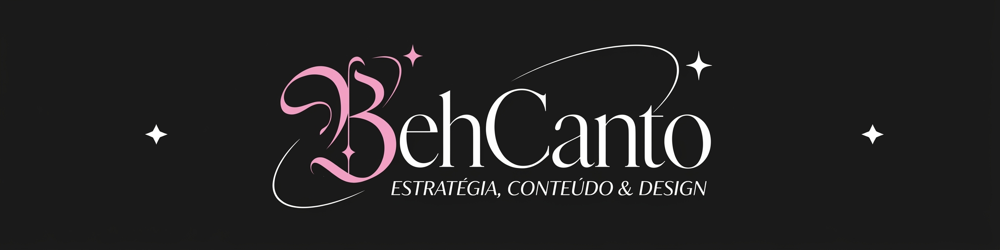

&nbsp;

<h2>★ Sobre mim</h2>

Me chamo Beatriz, sou uma carioca que cresceu no nordeste, formada em Ciência  
da Computação e Marketing Digital. Atualmente trabalho como Social Media, com  
foco em estratégia de conteúdo, análise de tráfego pago e método SEO. Também  
trabalho com Design Gráfico e identidade visual. Além disso, sou ilustradora  
amadora nas horas vagas, viciada em café e doces e tenho um gato antissocial  
chamado Harry.

**★ Habilidades:**  
 

